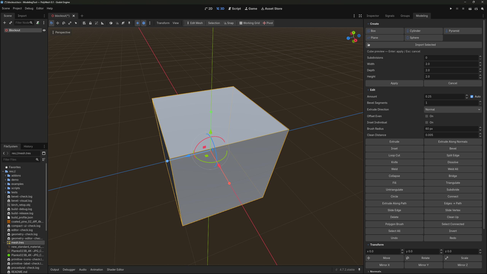
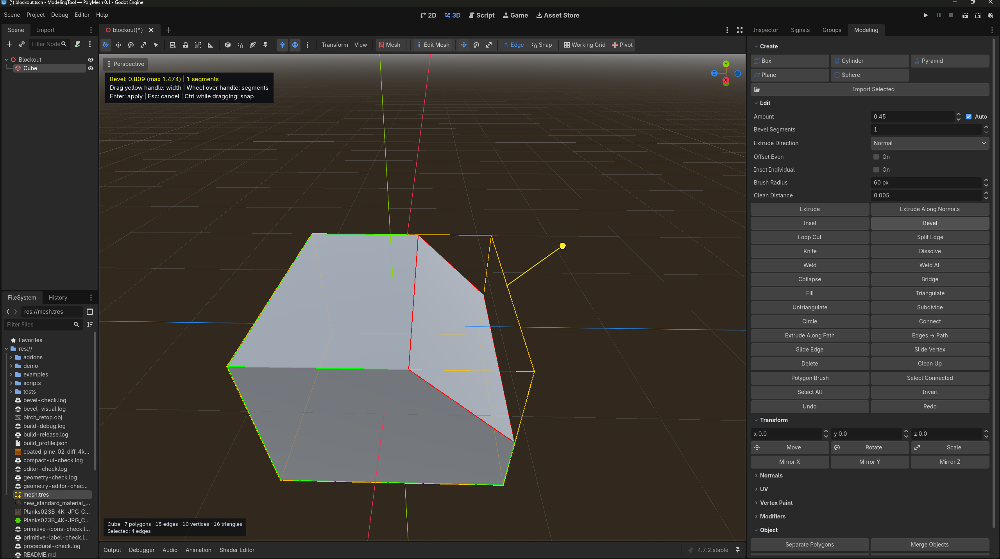
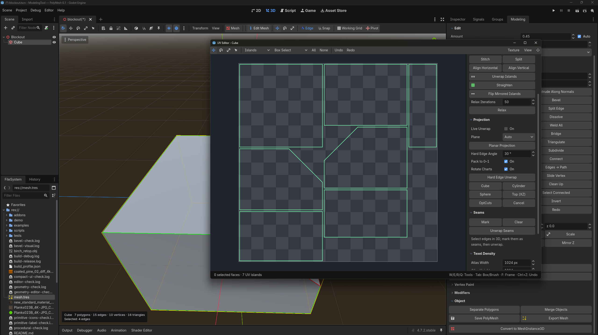
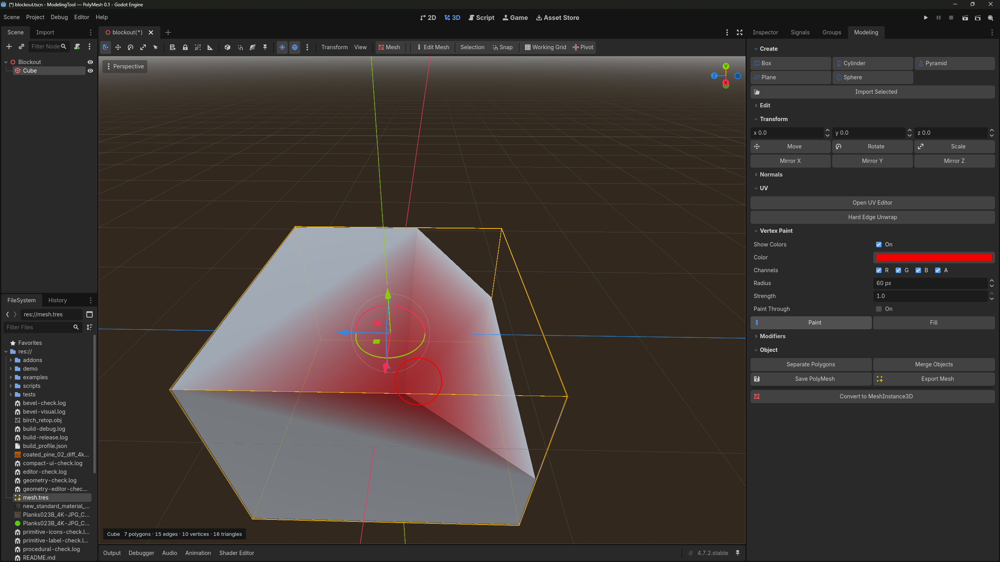
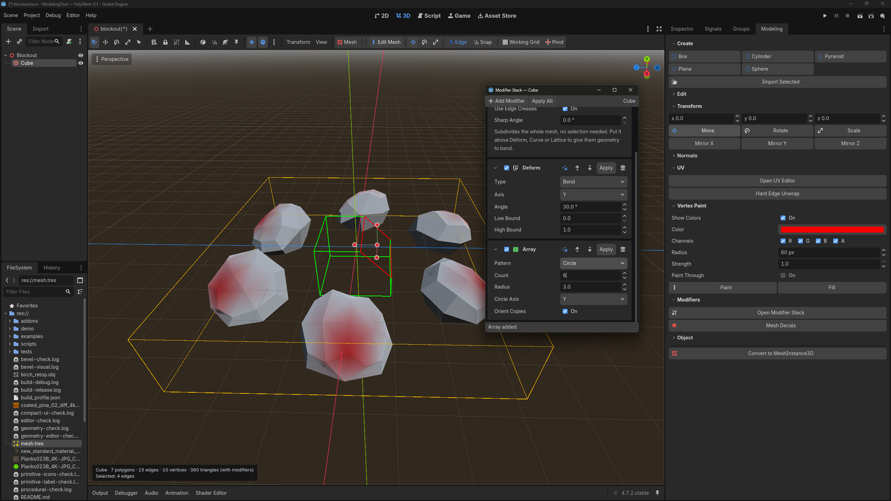

# GD Modeling Tools

Аддон для 3D-моделирования прямо в редакторе Godot: создание примитивов, редактирование полигонов, UV-развёртка, раскраска вершин и стек модификаторов.

## Установка

Скопируйте папку `addons/modeling_tool` в свой проект Godot, перезапустите редактор и включите **ModelingTool** в **Project → Project Settings → Plugins**.

Поставляемые библиотеки предназначены для **Windows x64, Godot 4.4+**. Подробнее об установке и работе с инструментами — в [руководстве](addons/modeling_tool/INSTALL.md).

## Скриншоты

### Создание объектов

Создание примитивов с настройкой размеров прямо в 3D-сцене.

### Полигональные инструменты

Редактирование геометрии в окне сцены: на примере показан инструмент Bevel для создания фасок.

### UV-редактор

Работа с UV-островами, проекциями и швами в отдельном окне редактора.

### Раскраска вершин

Нанесение цвета кистью с настройкой радиуса, силы и каналов RGBA.

### Стек модификаторов

Комбинирование модификаторов: на примере показаны деформация и круговой массив.

